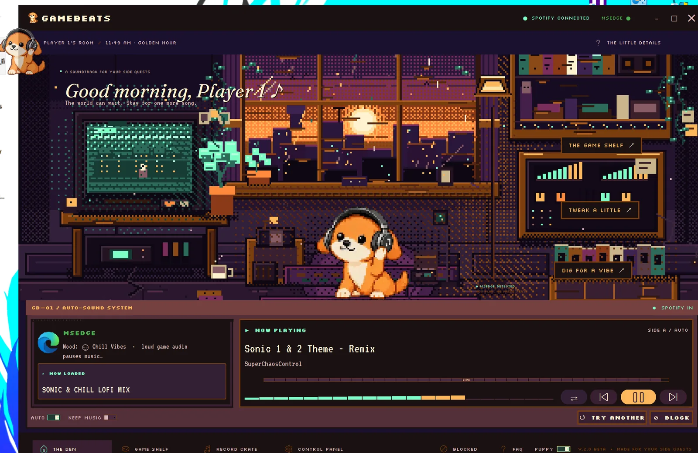

<div align="center">

# GameBeats

**Your games deserve a better soundtrack.**

GameBeats is a non-intrusive Windows music companion that keeps the right Spotify playlist playing while you game — automatically. It detects the game you launch, listens to what is actually coming out of your speakers, pauses the music when the action gets loud, brings it back when things quiet down, and offers the next playlist when one runs out.

No alt-tabbing. No focus stealing. Just you, the game, and the good boy.

[**Download for Windows**](https://ssaborr.itch.io/gamebeats) &nbsp;·&nbsp; [How it works](#how-it-works) &nbsp;·&nbsp; [Build from source](#build-from-source) &nbsp;·&nbsp; [Troubleshooting](#troubleshooting)

[](#requirements)
[](#build-from-source)
[](#spotify-setup)
[](LICENSE)



</div>

---

## Why GameBeats?

- **Your game keeps 100% focus.** Song changes, playlist transitions, and the puppy notifier all work without stealing keyboard or mouse input.
- **The music reacts to the game.** Loud gameplay audio pauses Spotify; quiet moments bring it back after a short delay.
- **The vibe never dies.** When a playlist ends, the puppy offers the next one with a countdown. Ignore it and the next playlist starts automatically.

---

## Features

### 🎮 Game-aware
- **Automatic game detection** — watches for the game process you launch, including titles started from Steam, Epic, GOG, and other launchers.
- **Custom game shelf** — add any `.exe` manually and map it to a mood, a genre, or a specific Spotify playlist.
- **Mood-based playlists** — games are matched to vibes like chill, epic, intense, focus, horror, and more using Steam tags and built-in mappings.
- **Smart playlist search** — finds playlists by game and mood, then remembers what worked.
- **Try another / block** — skip a playlist you do not like and block it from coming back.

### 🔊 Audio-aware
- **WASAPI loopback monitoring** — compares game and Spotify audio levels in real time.
- **Auto-pause for game audio** — music ducks out of the way when dialogue, gunfire, or a cutscene gets loud.
- **Auto-resume** — music returns when the room has been quiet for your chosen delay.
- **Playlist-end detection** — notices when the queue runs dry and starts the next-vibe flow.
- **Process-level loopback** — captures the target game and Spotify separately when Windows supports it, with a default-device fallback.

### 🐶 Zero-focus-stealing overlay
- **Non-activating puppy notifier** — built with native Win32 flags (`WS_EX_NOACTIVATE`, `WS_EX_TOOLWINDOW`, `HWND_TOPMOST`) so clicking it does not pull focus from borderless or windowed games.
- **Countdown + click-to-play** — accept the next playlist with a click, the global hotkey, or by letting the timer finish.
- **Animated mascot** — idle, singing, thinking, and playlist-change states.
- **Puppy toggle** — keep the desktop companion on, or switch it off for a cleaner screen.

### 🎵 Spotify without the setup
- **Browser-based playback** — GameBeats runs its own Spotify web-player session in a helper Chrome window.
- **Free or Premium** — no Premium account required.
- **No developer app, API keys, or redirect URIs** — sign in once and the session stays local.
- **Shuffle sync** — the GameBeats shuffle button and the Spotify web player stay in sync.
- **Optional desktop sidecar** — Spotify Desktop can be used alongside the app; a native focus guard keeps it from forcing itself into the foreground.

### 🖥️ Native Windows feel
- **CustomTkinter interface** with the pixel "den" theme, game shelf, record crate, control panel, and FAQ.
- **System tray support** — play/pause, next track, show, and exit from the tray; optional hide-to-tray and start-minimized modes.
- **Single-instance guard** — relaunching focuses the existing window instead of starting a second copy.
- **Everything local** — settings, game mappings, playlists, and the Spotify login stay on your PC. No telemetry.

---

## How it works

```text
┌─────────────────────────────────────────────────────────────┐
│                         GAME WINDOW                         │
│                    keeps 100% of your focus                 │
└───────────────────────────┬─────────────────────────────────┘
                            │  WASAPI / process loopback
                            ▼
┌─────────────────────────────────────────────────────────────┐
│                    GAMEBEATS MONITORING                     │
│  process detector  ·  audio monitor  ·  state dispatcher    │
└───────────────┬─────────────────────────────┬───────────────┘
                │                             │
                ▼                             ▼
┌───────────────────────────────┐   ┌─────────────────────────┐
│      PUPPY NOTIFIER           │   │    SPOTIFY CONTROLLER   │
│  topmost, never takes focus   │   │  Chrome web player      │
│  countdown + next-playlist    │   │  shuffle / queue / etc. │
└───────────────────────────────┘   └─────────────────────────┘
```

1. **Detect** — GameBeats scans running processes and matches the game against your shelf or the built-in database.
2. **Pick a vibe** — it loads the playlist mapped to that game, or searches Spotify using the game's mood and tags.
3. **Listen** — loopback audio monitoring compares game output with Spotify output.
4. **React** — loud game audio pauses the music; sustained quiet resumes it.
5. **Continue** — at the end of a playlist, the puppy appears with a countdown and a next-playlist prompt.
6. **Stay out of the way** — every interaction is designed to leave game input focus untouched.

---

## Download & install

### Installer (recommended)

1. Download **`GameBeatsSetup.exe`** from [itch.io](https://ssaborr.itch.io/gamebeats) or the [latest GitHub release](https://github.com/ssaborr/gamebeats/releases/latest).
2. Run the installer and launch **GameBeats**.
3. Sign in to Spotify in the helper Chrome window that opens on first launch.

If Windows SmartScreen asks for confirmation, choose **More info → Run anyway** only when the installer came from the official itch.io page or GitHub releases.

### From source

```bash
git clone https://github.com/ssaborr/gamebeats.git
cd gamebeats
python -m venv .venv
.venv\Scripts\activate
pip install -r source\requirements.txt
python -m playwright install chromium
python source\main.py
```

> Google Chrome is recommended because it ships with Widevine, which the Spotify web player needs. If Chrome is not installed, GameBeats falls back to Playwright's bundled Chromium.

### Spotify setup

GameBeats plays Spotify through its own browser session — **no developer app, client ID, API key, or desktop client is required**.

1. Launch GameBeats.
2. On first run, a Spotify login window opens.
3. Sign in with the account you want GameBeats to control.
4. The session is saved locally in `spotify_web_profile` and reused on future launches.

Spotify Desktop is optional. If you use it alongside GameBeats, the native focus guard prevents it from stealing game focus during track changes.

---

## Using GameBeats

1. Open **Game Shelf** and add the games you play, or let automatic detection pick them up.
2. Choose a mood or a specific playlist for each game.
3. Launch the game. GameBeats starts the matching music and begins monitoring audio.
4. When the playlist ends, the puppy appears. Click it, press the hotkey, or ignore it and the next playlist starts automatically.

### Controls

| Action | How |
|---|---|
| Play / pause | Player deck button or tray menu |
| Next track | Player deck button or tray menu |
| Accept next playlist | `Ctrl+Alt+N` while the puppy prompt is visible |
| Try another playlist | **TRY ANOTHER** in the player deck |
| Block a playlist | **BLOCK** in the player deck |
| Toggle the desktop puppy | **PUPPY** toggle in the footer or Control Panel |
| Hide to tray | Minimize with **hide to tray** enabled in the Control Panel |
| Show the app | Double-click the tray icon or relaunch GameBeats |

---

## Requirements

| | |
|---|---|
| **OS** | Windows 10 or Windows 11 (64-bit) |
| **Spotify** | Free or Premium account |
| **Browser** | Google Chrome recommended; Playwright Chromium fallback |
| **Python** | 3.10+ only when running or building from source (3.13 recommended) |
| **C++ compiler** | Optional — MinGW-w64 (`g++`) to rebuild the native focus guard |

---

## Configuration & data

GameBeats keeps everything local.

| Location | Used for |
|---|---|
| `%APPDATA%\GameBeats\` | Installed builds: settings, Spotify session, caches, and logs |
| `source\` | Running from source: the same files live beside `main.py` |
| `<install>\data\games.json` | Game mappings for installed builds |

| File / folder | Purpose |
|---|---|
| `config.json` | Playback mode, overlay and tray preferences, login state, audio thresholds |
| `games.json` | Game → mood / playlist mappings |
| `saved_playlists.json` | Playlists you saved while browsing |
| `blocked_playlists.json` | Playlists you blocked from being picked again |
| `playlist_search_cache.json` | Cached Spotify search results |
| `spotify_web_profile\` | Persistent Spotify web login — **treat this like a password** |
| `gamebeats.log` | Runtime log used for troubleshooting |

> Do not commit `spotify_web_profile`, `config.json`, or `tokens.json`. They contain account and machine-specific data.

---

## Build from source

### Quick development build (PyInstaller)

From the repository root:

```bash
BUILD_AND_RUN.bat
```

This script:

- installs Python dependencies;
- rebuilds `spotify_focus_guard.exe` when MinGW-w64 is available;
- packages the app with PyInstaller into `dist/GameBeats/`;
- launches `GameBeats.exe` from the correct folder.

The runnable output is **`dist/GameBeats/GameBeats.exe`**. Never run the executable from `build_tmp/` — that folder is missing runtime files.

### Release build (Nuitka + Inno Setup)

```bash
BUILD_RELEASE.bat
```

This produces:

- `dist_release/GameBeats/GameBeats.exe` — standalone application folder;
- `installer_output/GameBeatsSetup.exe` — installer, when [Inno Setup 6](https://jrsoftware.org/isinfo.php) is installed.

### Manual PyInstaller build

See [BUILD.md](BUILD.md) for the full command, icon setup, and spec-file workflow.

### Native focus guard

```bash
COMPILE_FOCUS_GUARD.bat
```

Requires MinGW-w64. The prebuilt `spotify_focus_guard.exe` is already included, so this is only needed when modifying the helper.

### Tests

```bash
pip install pytest
python -m pytest tests
```

---

## Project structure

```text
gamebeats/
├── assets/                       # Icons, mascot art, fonts, screenshots
├── data/                         # Runtime game data for packaged builds
├── include/                      # Native header dependencies (MinHook)
├── installer/                    # Inno Setup script
├── lib/                          # Native static libraries
├── minhook-1.3.4/                # MinHook source and license
├── puppies/                      # Mascot design source images
├── source/
│   ├── core/
│   │   ├── audio_monitor.py      # WASAPI / process loopback monitoring
│   │   ├── detector.py           # Process scanner + game registry
│   │   ├── game_tags.py          # Steam tag lookup and mood mapping
│   │   ├── global_hotkey.py      # Ctrl+Alt+N listener
│   │   ├── playback_guard.py     # Suppresses commands during playback start
│   │   ├── playlist_search.py    # Spotify playlist search and caching
│   │   ├── playlist_scraper.py   # Playlist track extraction
│   │   ├── spotify_web.py        # Browser-based Spotify controller
│   │   ├── spotify_desktop.py    # Optional desktop-client controller
│   │   └── spotify_focus_guard.exe
│   ├── ui/
│   │   ├── app.py                # Main window and application flow
│   │   ├── games_page.py         # Game shelf and mapping editor
│   │   ├── mascot_notifier.py    # Non-activating puppy overlay
│   │   ├── onboarding.py         # First-run flow
│   │   ├── theme.py              # Pixel-den theme
│   │   ├── runtime_overlay.py    # Runtime status overlay
│   │   └── spotify_window_guard.py
│   ├── main.py                   # Entry point + single-instance guard
│   ├── requirements.txt
│   └── spotify_focus_guard.cpp   # Native focus-guard source
├── tests/                        # Regression and UI behavior tests
├── BUILD.md                      # PyInstaller details
├── BUILD_AND_RUN.bat             # Development build + launch
├── BUILD_RELEASE.bat             # Nuitka + installer release build
├── COMPILE_FOCUS_GUARD.bat       # Rebuild the native helper
├── COMPLETE_ARCHITECTURE.md      # Deeper architecture notes
├── LAUNCH.bat                    # Launch an existing PyInstaller build
└── README.md
```

---

## Troubleshooting

**Spotify logs in but plays no sound**
Install Google Chrome so the web player can use Widevine, or run `python -m playwright install chromium` and relaunch. If the session is stale, close GameBeats, delete `spotify_web_profile`, and sign in again.

**The login window keeps appearing**
Make sure the data folder is writable. For installed builds that is usually `%APPDATA%\GameBeats`; for source runs it is `source\`. Do not run the app from a read-only folder.

**A game is not detected**
Use the real game `.exe`, not a desktop shortcut or a Steam URL. If the game runs as administrator, run GameBeats as administrator too so it can see the process.

**Music never pauses or resumes**
Check that game audio is playing through the default output device and that Windows is not muting the loopback device. Review the thresholds in the Control Panel, and check `gamebeats.log` for the active audio backend.

**The puppy overlay is hidden in fullscreen**
The overlay is designed for borderless and windowed games. Exclusive-fullscreen games may render above it; switch the game to borderless windowed mode. Audio detection and playback continue regardless.

**Spotify Desktop steals focus**
Run `COMPILE_FOCUS_GUARD.bat` to rebuild the native helper, then restart GameBeats. The prebuilt helper is used automatically when present.

**The app opens and immediately closes**
Check `%APPDATA%\GameBeats\gamebeats.log` (or `source\gamebeats.log`). A crash report may also be written to `gamebeats_crash.txt` on your Desktop.

**Windows SmartScreen blocks the installer**
Use **More info → Run anyway** only if you downloaded the installer from the official itch.io page or GitHub releases.

---

## FAQ

**Is GameBeats free?**
Yes. No subscription, no ads, and no premium tier.

**Do I need Spotify Premium?**
No. Free and Premium accounts both work through the web player.

**Do I need Spotify Desktop?**
No. GameBeats uses its own Chrome-based Spotify session. The desktop client is optional.

**Do I need to create a Spotify developer app?**
No. There is no API key, client ID, or redirect URI to configure.

**Does GameBeats modify my games?**
No. It only observes processes and audio, and controls Spotify playback.

**Does it send my data anywhere?**
No account data is sent to the developer. Settings, mappings, and the Spotify session stay on your PC.

**Does it work with any game?**
Any game that runs as a detectable process. Popular titles are mapped automatically; everything else can be added manually from the Game Shelf.

---

## Contributing & support

- **Download / support the project:** [ssaborr.itch.io/gamebeats](https://ssaborr.itch.io/gamebeats)
- **Bug reports and feature requests:** [GitHub Issues](https://github.com/ssaborr/gamebeats/issues)
- **Pull requests:** welcome — keep changes consistent with the existing style and run `python -m pytest tests` before submitting.
- **Logs help:** include the relevant part of `gamebeats.log` and your Windows version in bug reports.

GameBeats is made by one developer and one very good boy. If it made your game nights better, the best support is simple: share it with a friend and leave a rating on itch.io.

---

## License

Released under the [MIT License](LICENSE).

GameBeats is not affiliated with Spotify, Steam, Epic Games, or any game publisher. Spotify is a trademark of Spotify AB.
